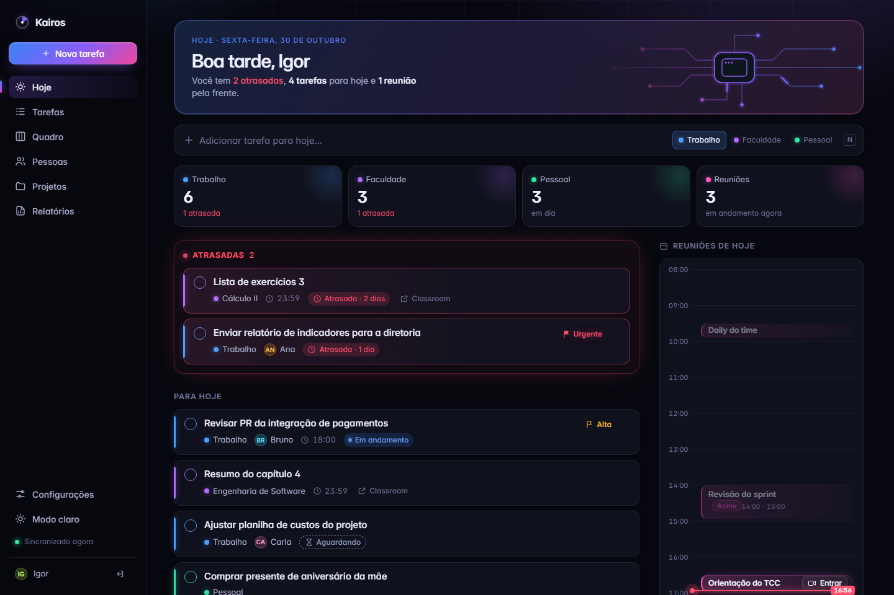
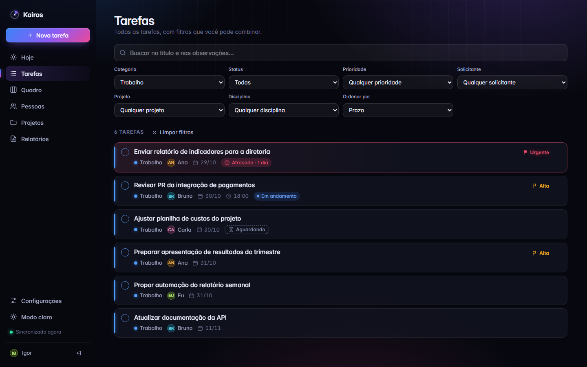
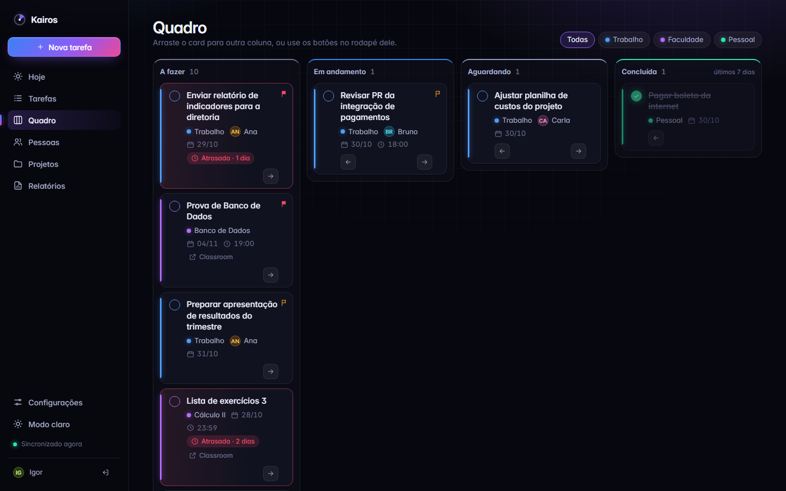
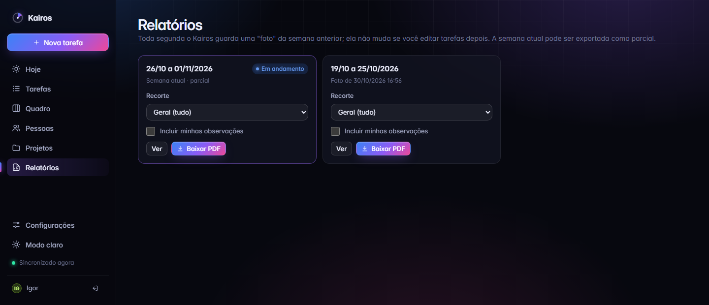
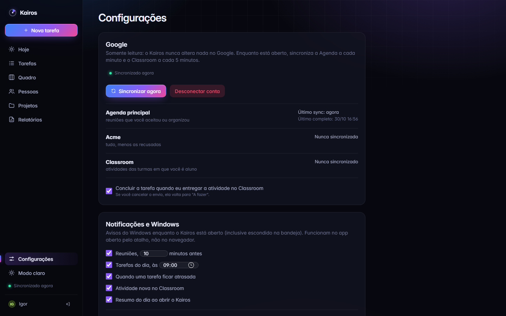
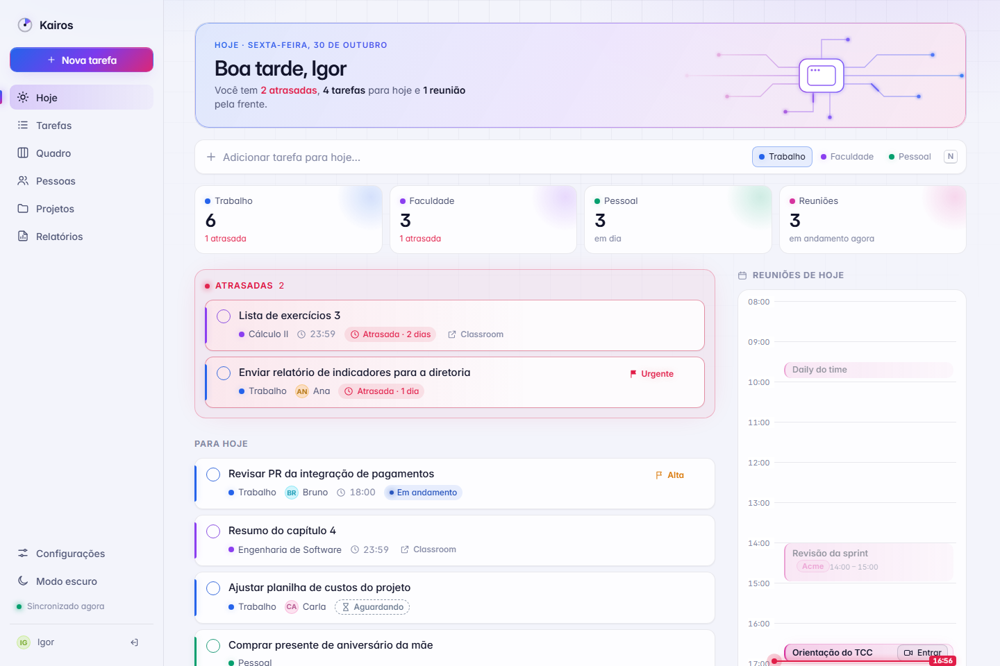
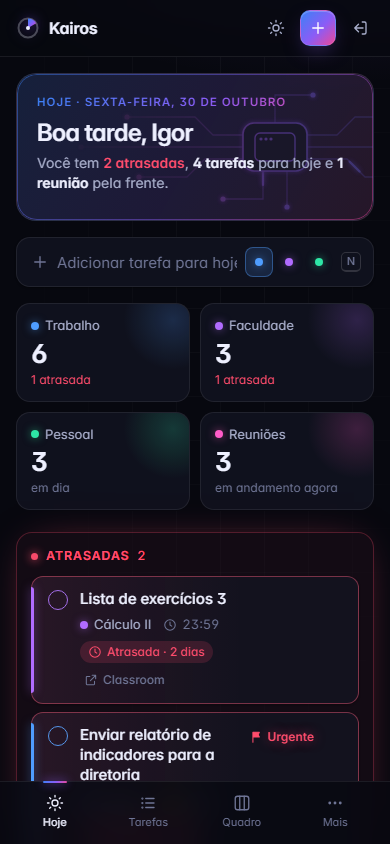

# Kairos

**Um lugar só para o meu dia:** demandas do trabalho (e quem pediu cada uma), reuniões do Google Agenda (pessoal e da empresa), atividades da faculdade vindas do Google Classroom e projetos pessoais. Roda no meu PC com Windows, numa janela própria, com ícone na bandeja e notificações.

> *Kairos* (grego): o momento oportuno, em oposição a *Chronos*, o tempo que só passa.



<sub>Prints feitos com dados de demonstração (`ferramentas/gerar_prints.py`), não com dados reais.</sub>

## O que ele faz

- **Hoje:** atrasadas no topo, tarefas do dia, próximos 7 dias e as reuniões numa linha do tempo (com "agora" e reuniões no mesmo horário lado a lado).
- **Tarefas:** filtros combináveis (categoria, status, prioridade, solicitante, projeto, disciplina) e busca que ignora acentos, tudo refletido na URL.
- **Quadro:** kanban por status; arrastar e soltar no computador, botões no celular.
- **Criação rápida** (tecla <kbd>N</kbd>), **concluir com um clique** e **desfazer** (inclusive exclusão, com <kbd>Ctrl</kbd>+<kbd>Z</kbd>).
- **Google Agenda (pessoal + empresa):** importa as reuniões aceitas, a cada minuto, só lendo o que mudou.
- **Google Classroom:** atividades viram tarefas da faculdade; entregar no Classroom conclui a tarefa.
- **Relatórios semanais em PDF:** uma "foto" de cada semana guardada toda segunda, com recortes (só trabalho para o gestor, só uma disciplina…).
- **Aplicativo do Windows:** janela própria, bandeja do sistema, iniciar com o Windows, notificações (reunião em 10 min, prazos do dia, atividade nova) e backup diário.
- **No notebook e no iPhone:** o mesmo Kairos, acessado pela rede privada do Tailscale e instalado como app (PWA).
- **Responsivo de verdade** e com **modo escuro** como padrão.

| | |
|---|---|
|  |  |
|  |  |
|  |  |

## Como funciona

```
 Janela do Windows (pywebview = motor do Edge)        Bandeja + notificações (NotifyIcon do Windows)
                 │ HTTP local                                        ▲
                 ▼                                                   │
   waitress ──► Django ──► SQLite (%LOCALAPPDATA%\Kairos)           │
                 ▲   HTMX troca pedaços de HTML gerados no servidor  │
                 │                                                   │
   Relógio do app (a cada minuto, mesmo com a janela fechada) ───────┘
     ├─ sync Google Agenda (incremental) e Classroom (a cada 5 min) — somente leitura
     ├─ foto semanal dos relatórios e backup diário
     └─ avisos (reunião, prazos, atrasadas, Classroom), sem repetir
```

- **O servidor é a fonte da verdade:** o HTMX pede ao Django o HTML já pronto; nenhuma regra de negócio é duplicada em JavaScript.
- **Ações desacopladas das telas:** cada ação só avisa "os dados mudaram" e cada tela se recarrega sozinha com os próprios filtros.
- **A janela é só uma moldura:** nada depende do pywebview; o mesmo site funciona no navegador do notebook e no iPhone (veja abaixo).

## Decisões que valem destacar

Todas estão em [docs/DECISOES.md](docs/DECISOES.md), cada uma com contexto, escolha e motivo. Algumas:

- **Sync incremental com o Google** (`syncToken`): o Google devolve só o que mudou, então consultar a cada minuto custa ~0,3% da cota gratuita. Reuniões apagadas são descobertas por **diferença de conjuntos** em O(n + m).
- **"Reagir à mudança, não ao estado":** o Classroom só conclui a tarefa quando a entrega *muda* para entregue; se eu reabrir a tarefa, o sync não briga comigo.
- **Desfazer exclusão sem "lixo" no banco:** a tarefa vira um texto assinado com a `SECRET_KEY` dentro do próprio botão "Desfazer" e é recriada idêntica.
- **Relatórios como foto congelada:** o que foi enviado ao gestor nunca muda, mesmo se eu editar ou excluir tarefas depois.
- **PDF e ícone sem pacote novo:** o Edge (que já vem no Windows) gera os PDFs e desenha o ícone; bandeja e notificações usam o `NotifyIcon` do próprio Windows.
- **Busca em português:** uma função Python registrada no SQLite faz "relatorio" achar "Relatório".
- **Segurança desde o início:** login obrigatório por middleware, proteção contra força bruta (django-axes), segredos no `.env`, dados fora da pasta do código, Google somente leitura.

## Tecnologias

Python 3.13 · Django 5.2 LTS · SQLite · HTMX 2 · Tailwind CSS 4 (executável standalone, sem Node) · pywebview · waitress · whitenoise · django-axes · API do Google (Agenda e Classroom)

## Testes

```powershell
venv\Scripts\python manage.py test     # 202 testes; o Google é simulado, nunca chamado de verdade
venv\Scripts\ruff check .              # verificador de código (pip install -r requirements-dev.txt)
```

## Rodar em desenvolvimento

Pré-requisito: Python 3.13.

```powershell
# 1. Ambiente virtual e dependências
py -3.13 -m venv venv
venv\Scripts\activate
pip install -r requirements-dev.txt

# 2. Configurar o .env (veja os comentários no .env.example)
copy .env.example .env
#    gere uma chave e cole em DJANGO_SECRET_KEY:
python -c "from django.core.management.utils import get_random_secret_key as g; print(g())"
#    neste PC de desenvolvimento: DJANGO_DEBUG=True e KAIROS_DB_NAME=dev.sqlite3

# 3. Banco, usuário e CSS (o Tailwind é baixado na primeira vez)
python manage.py migrate
python manage.py createsuperuser
python manage.py tailwind build

# 4. (opcional) dados de demonstração — só roda no dev.sqlite3
python manage.py dados_exemplo

# 5. Rodar
python manage.py runserver
```

`python manage.py tailwind watch` (em outro terminal) regera o CSS a cada mudança nos templates.

## Instalar como aplicativo (PC de uso)

```powershell
# 1. Passos 1 a 3 acima, com pip install -r requirements.txt.
#    No .env deste PC: KAIROS_DB_NAME=kairos.sqlite3 (banco real).
#    DJANGO_DEBUG não importa: o app sempre roda em modo produção.

# 2. Google: crie um cliente OAuth "App para computador" no Google Cloud (sem faturamento),
#    salve o credentials.json em %LOCALAPPDATA%\Kairos\ e conecte em Configurações → Conectar conta Google.
#    Para a agenda da empresa: GOOGLE_AGENDAS_EXTRAS=Empresa=email@empresa.com no .env.

# 3. Atalho na área de trabalho:
powershell -ExecutionPolicy Bypass -File .\criar_atalho.ps1
```

Ao abrir, o Kairos faz backup do banco antes de aplicar migrations, guarda um backup por dia (últimos 14, em `%LOCALAPPDATA%\Kairos\backups\`) e registra erros em `%LOCALAPPDATA%\Kairos\kairos.log`. Fechar a janela só a esconde na bandeja; para sair, use **Sair** no ícone da bandeja.

## Acesso pelo notebook e pelo iPhone

Um Kairos só (no PC de casa), para os dados nunca divergirem. Os outros aparelhos chegam até ele pela rede privada do [Tailscale](https://tailscale.com) (plano gratuito):

```
 iPhone (app na Tela de Início) ─┐   rede privada do Tailscale    ┌─ PC de casa
 notebook (app do Edge) ─────────┴── https://kairos.<rede>.ts.net ─┴─ Tailscale Serve ──► Kairos (127.0.0.1:8765)
```

- O Kairos continua escutando só em `127.0.0.1`; o **Tailscale Serve** recebe o HTTPS (certificado válido, sem abrir porta no roteador) e repassa. Nada fica exposto na internet.
- `KAIROS_DOMINIO_REMOTO` no `.env` libera o endereço no Django; o bloqueio por senha errada usa o IP real de cada aparelho (`tarefas/seguranca.py`).
- É um **PWA**: manifesto, ícones e áreas seguras do iPhone. No Safari: Compartilhar → Adicionar à Tela de Início. No Edge: Aplicativos → Instalar este site como um aplicativo.

```powershell
tailscale serve --bg 8765     # uma vez, no PC de casa (fica ligado após reiniciar)
```

## Estrutura

```
config/                 configurações do Django (settings, urls)
tarefas/
  models.py             Tarefa, Pessoa, Projeto, Disciplina, preferências, relatórios, avisos
  consultas.py          regras de listagem (atrasadas, próximos 7 dias, quadro, busca)
  views*.py             telas e ações (HTMX)
  google/               sync da Agenda e do Classroom (somente leitura)
  relatorios.py, pdf.py relatórios semanais e PDF pelo Edge
  notificacoes.py       o que avisar (sem saber nada de Windows)
  backup.py, windows.py backup do SQLite e integração com o Registro do Windows
  tests/                202 testes
templates/, static/     HTML, CSS (Tailwind), HTMX, JS, fonte e ícone
iniciar.pyw             abre o app (servidor + janela + bandeja + relógio)
ferramentas/            gerar o ícone e os prints do README
docs/                   especificação, decisões, protótipo visual e prints
```

## Privacidade

O Kairos é de uso pessoal, só **lê** o Google e guarda tudo no próprio computador. Detalhes em [PRIVACIDADE.md](PRIVACIDADE.md).

## Desenvolvido com auxílio de IA

Este projeto foi desenvolvido com auxílio do **Claude Code** (IA da Anthropic). Eu defini os requisitos e a especificação, aprovei o visual, testei cada etapa com meus dados reais, revisei o código e tomei as decisões técnicas, registradas com os motivos em [docs/DECISOES.md](docs/DECISOES.md). O histórico de commits mostra a evolução etapa por etapa.
